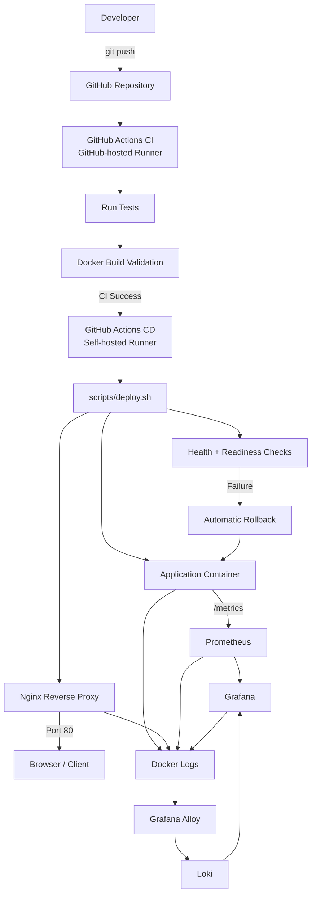

# Personal DevOps Platform

> **Reusable CI/CD, Deployment, Rollback, and Observability Foundation for My Software Projects**

Personal DevOps Platform is a reusable DevOps foundation designed to standardize how I test, build, deploy, monitor, and recover my software projects.

Instead of creating a new CI/CD pipeline and deployment environment from scratch for every project, this platform provides a common workflow that can be reused and gradually adapted across different application stacks.

The current reference implementation uses a Python/Flask application running locally on Windows + WSL2 with Docker Desktop.

---

## Why This Project Exists

This project originally started as a CI/CD portfolio project.

It has since evolved into a reusable personal platform that I intend to use as part of my standard software development workflow.

The long-term goal is simple:

```text
New Software Project
        |
        v
Connect Personal DevOps Platform
        |
        v
Tests
        |
        v
Continuous Integration
        |
        v
Build
        |
        v
Continuous Deployment
        |
        v
Health Verification
        |
        v
Rollback Protection
        |
        v
Metrics + Logs
```

The target is for a new project to adopt this workflow in approximately **30 minutes or less**.

---

# Features

The current platform provides:

- GitHub Actions Continuous Integration
- GitHub-hosted CI runner
- Self-hosted deployment runner
- Automated Python tests with pytest
- Docker image build validation
- Docker Compose deployment
- Nginx reverse proxy
- Application health checks
- Nginx readiness checks
- Deployment smoke tests
- Automatic rollback
- Prometheus metrics
- Grafana dashboards
- Loki centralized logging
- Grafana Alloy log collection
- CI-to-CD dependency
- Deployment failure testing
- Local production-like deployment environment

---

# Architecture



---

# CI/CD Workflow

## Continuous Integration

CI runs on a GitHub-hosted runner.

The CI pipeline currently performs:

```text
Git Push / Pull Request
        |
        v
Checkout Repository
        |
        v
Setup Python
        |
        v
Install Dependencies
        |
        v
Run pytest
        |
        v
Build Docker Image
        |
        v
CI Success
```

CI is intentionally separated from the self-hosted deployment environment.

This reduces the amount of privileged code running on my local machine.

---

## Continuous Deployment

CD runs only after CI completes successfully.

The CD workflow uses a self-hosted GitHub Actions runner running inside WSL2.

```text
CI Success
    |
    v
Local CD Workflow
    |
    v
Self-hosted Runner
    |
    v
scripts/deploy.sh
    |
    +--> Save previous image
    |
    +--> Build new image
    |
    +--> Deploy application
    |
    +--> Wait for application health
    |
    +--> Recreate Nginx
    |
    +--> Wait for Nginx readiness
    |
    +--> Run public smoke test
    |
    +--> Success
    |
    +--> Failure -> Rollback
```

---

# Automatic Rollback

Before a deployment starts, the currently working application image is preserved as a rollback image.

If the new release fails any critical deployment check, the deployment script restores the previous image.

Failure conditions include:

- Application becomes unhealthy
- Application never becomes healthy
- Nginx becomes unhealthy
- Nginx never becomes healthy
- Public endpoint smoke test fails
- Deployment command returns an unexpected error

Rollback flow:

```text
Previous Healthy Application
        |
        v
Save Rollback Image
        |
        v
Deploy New Release
        |
        v
Health Check
        |
      FAILED
        |
        v
Automatic Rollback
        |
        v
Restore Previous Image
        |
        v
Healthy Service Restored
```

The rollback mechanism has been regression-tested using an intentionally unhealthy application release.

---

# Observability

The platform includes both metrics and centralized logging.

---

## Metrics

The Flask application exposes:

```text
/metrics
```

Prometheus scrapes this endpoint.

```text
Flask Application
       |
       | /metrics
       v
Prometheus
       |
       v
Grafana
```

The Prometheus target currently appears as:

```text
Job: flask-app
Target: http://app:5000/metrics
Health: up
```

---

## Grafana Dashboard

The main dashboard is:

```text
Personal DevOps Platform - Application Overview
```

It currently contains:

### HTTP Request Rate

Measures application request throughput.

```promql
sum(
  rate(
    flask_http_request_total{
      job="flask-app"
    }[1m]
  )
)
```

Unit:

```text
requests/sec
```

---

### HTTP 5xx Error Rate

Calculates the percentage of requests returning server errors.

```promql
100 *
(
  sum(
    rate(
      flask_http_request_total{
        job="flask-app",
        status=~"5.."
      }[5m]
    )
  )
  or vector(0)
)
/
clamp_min(
  sum(
    rate(
      flask_http_request_total{
        job="flask-app"
      }[5m]
    )
  ),
  0.000001
)
```

Recommended unit:

```text
Percent (0-100)
```

Recommended range:

```text
Min: 0
Max: 100
```

---

### P95 Request Latency

Displays the request latency experienced by approximately 95% of requests.

Internal monitoring endpoints are excluded.

```promql
histogram_quantile(
  0.95,
  sum by (le) (
    rate(
      flask_http_request_duration_seconds_bucket{
        job="flask-app",
        path!~"^/(health|metrics)$"
      }[5m]
    )
  )
)
```

Metric unit:

```text
seconds
```

Grafana automatically displays small values as milliseconds.

---

### Application Health

Prometheus availability is used as an application health indicator.

```promql
up{job="flask-app"}
```

Recommended Grafana value mapping:

```text
1 -> Healthy
0 -> Down
```

---

# Centralized Logging

Application and infrastructure logs are collected using Grafana Alloy and stored in Loki.

```text
Docker Containers
       |
       v
Grafana Alloy
       |
       v
Loki
       |
       v
Grafana Explore
```

Grafana Alloy discovers containers through:

```text
/var/run/docker.sock
```

Container names are stored in Loki using the label:

```text
service_name
```

Examples:

```text
cicd-portfolio-app
cicd-portfolio-nginx
cicd-portfolio-prometheus
cicd-portfolio-grafana
cicd-portfolio-loki
cicd-portfolio-alloy
```

Example LogQL query:

```logql
{service_name="cicd-portfolio-app"}
```

Example application logs:

```text
"GET / HTTP/1.1" 200
"GET /health HTTP/1.1" 200
"GET /metrics HTTP/1.1" 200
```

---

# Technology Stack

| Area | Technology |
|---|---|
| Source Control | Git |
| Repository | GitHub |
| Continuous Integration | GitHub Actions |
| CI Runner | GitHub-hosted Runner |
| Continuous Deployment | GitHub Actions |
| CD Runner | Self-hosted GitHub Actions Runner |
| Operating Environment | Windows + WSL2 Ubuntu |
| Application | Python / Flask |
| Testing | pytest |
| Containerization | Docker |
| Local Orchestration | Docker Compose |
| Reverse Proxy | Nginx |
| Metrics | Prometheus |
| Dashboard | Grafana |
| Log Collector | Grafana Alloy |
| Log Storage | Loki |

---

# Repository Structure

```text
.
├── .github/
│   └── workflows/
│       ├── ci.yml
│       └── deploy.yml
│
├── monitoring/
│   ├── alloy/
│   │   └── config.alloy
│   │
│   ├── loki/
│   │   └── loki.yml
│   │
│   └── prometheus/
│       └── prometheus.yml
│
├── nginx/
│   └── default.conf
│
├── scripts/
│   └── deploy.sh
│
├── tests/
│   └── test_app.py
│
├── app.py
├── compose.yml
├── Dockerfile
├── requirements.txt
├── .dockerignore
├── .env.example
├── .gitignore
└── README.md
```

---

# Prerequisites

The current reference environment uses Windows with WSL2.

Recommended requirements:

- Windows 10 or Windows 11
- WSL2
- Ubuntu for WSL
- Docker Desktop
- Docker Desktop WSL Integration
- Git
- GitHub account
- Python 3.x
- Internet access for initial Docker image downloads

---

# Installation

## 1. Install WSL2

From PowerShell as Administrator:

```powershell
wsl --install
```

Restart Windows if requested.

Verify:

```powershell
wsl --status
```

---

## 2. Install Ubuntu

Ubuntu can be installed automatically through:

```powershell
wsl --install -d Ubuntu
```

Launch Ubuntu after installation.

---

## 3. Install Docker Desktop

Install Docker Desktop on Windows.

After installation:

```text
Docker Desktop
-> Settings
-> Resources
-> WSL Integration
-> Enable Ubuntu
```

Restart Docker Desktop if required.

---

## 4. Verify Docker from WSL

Open Ubuntu:

```bash
docker --version
```

Then:

```bash
docker info
```

Both commands should return Docker information.

Test Docker:

```bash
docker run hello-world
```

Expected result:

```text
Hello from Docker!
```

---

# Clone the Repository

Inside WSL:

```bash
git clone https://github.com/farhanfoxy/cicd-portfolio.git
```

Enter the project:

```bash
cd cicd-portfolio
```

---

# Environment Configuration

Create the local environment file:

```bash
cp .env.example .env
```

Review it:

```bash
nano .env
```

The current configuration supports environment-specific values such as:

```text
APP_NAME
PUBLIC_PORT
```

Do not commit `.env`.

Only `.env.example` should be stored in Git.

---

# Start the Platform

Build and start all containers:

```bash
docker compose up -d --build
```

Check service status:

```bash
docker compose ps
```

Expected services:

```text
app
nginx
prometheus
grafana
loki
alloy
```

The application and Nginx should report:

```text
healthy
```

The remaining observability services should be:

```text
Up
```

---

# Verify the Application

Open:

```text
http://localhost
```

or:

```bash
curl http://localhost
```

---

# Verify Application Health

```bash
curl http://localhost/health
```

Expected response:

```json
{"status":"healthy"}
```

---

# Service URLs

| Service | Address |
|---|---|
| Application | `http://localhost` |
| Application Health | `http://localhost/health` |
| Prometheus | `http://localhost:9090` |
| Grafana | `http://localhost:3000` |

Loki and Alloy are intentionally not exposed to the Windows host.

They communicate through the internal Docker network.

---

# Local Python Development

Create a virtual environment:

```bash
python3 -m venv venv
```

Activate it:

```bash
source venv/bin/activate
```

Install dependencies:

```bash
pip install -r requirements.txt
```

Run tests:

```bash
python -m pytest
```

Expected:

```text
1 passed
```

---

# Grafana Setup

Open:

```text
http://localhost:3000
```

For a fresh Grafana installation, the default login is commonly:

```text
Username: admin
Password: admin
```

Grafana may request that the password be changed during first login.

If the Grafana volume already exists, use the password previously configured.

---

# Configure Prometheus in Grafana

Navigate to:

```text
Connections
-> Data Sources
-> Add Data Source
-> Prometheus
```

Use:

```text
http://prometheus:9090
```

Then click:

```text
Save & Test
```

Expected:

```text
Successfully queried the Prometheus API
```

---

# Configure Loki in Grafana

Navigate to:

```text
Connections
-> Data Sources
-> Add Data Source
-> Loki
```

Use:

```text
http://loki:3100
```

Then:

```text
Save & Test
```

Expected:

```text
Data source successfully connected
```

---

# Using Grafana Logs

Open:

```text
Grafana
-> Explore
-> Loki
```

Query application logs:

```logql
{service_name="cicd-portfolio-app"}
```

Generate test traffic:

```bash
for i in {1..5}; do
  curl -s http://localhost/ > /dev/null
done
```

Refresh Grafana Explore.

New HTTP logs should appear.

---

# Running a Manual Deployment

The deployment script is located at:

```text
scripts/deploy.sh
```

Run:

```bash
./scripts/deploy.sh
```

The script performs:

```text
Save current image
        |
        v
Build new image
        |
        v
Deploy application
        |
        v
Application health check
        |
        v
Nginx recreation
        |
        v
Nginx readiness check
        |
        v
Public smoke test
        |
        v
Deployment successful
```

---

# Using GitHub CI/CD

The intended daily workflow is simple.

Make your code changes.

Then:

```bash
git add .
```

Commit:

```bash
git commit -m "Your change description"
```

Push:

```bash
git push
```

The platform then automatically runs:

```text
git push
   |
   v
GitHub Actions CI
   |
   +--> pytest
   |
   +--> Docker build validation
   |
   v
CI Successful
   |
   v
Local CD Pipeline
   |
   v
Self-hosted Runner
   |
   v
Automatic Deployment
```

---

# Self-Hosted GitHub Actions Runner

CD requires a self-hosted runner.

The runner should only be used for trusted deployment workflows.

Do not place temporary registration tokens in source code or documentation.

---

## Register a Runner

Open the GitHub repository.

Navigate to:

```text
Settings
-> Actions
-> Runners
-> New self-hosted runner
```

Choose:

```text
Linux
x64
```

GitHub will generate installation and registration commands.

Follow those commands inside WSL.

---

## Start the Runner

For the current environment:

```bash
cd ~/actions-runner
```

Then:

```bash
./run.sh
```

Expected:

```text
Connected to GitHub
Listening for Jobs
```

Keep this terminal running while deployments are expected.

---

# CD Workflow Queued

If GitHub shows:

```text
Local CD Pipeline
Queued
```

the self-hosted runner may be offline.

Check:

```bash
pgrep -af Runner.Listener || echo "Self-hosted runner is NOT running"
```

Start it again:

```bash
cd ~/actions-runner
./run.sh
```

---

# Verify CI/CD

After pushing a commit:

Open:

```text
GitHub
-> Repository
-> Actions
```

Expected sequence:

```text
CI Pipeline
     |
     v
Success
     |
     v
Local CD Pipeline
     |
     v
Success
```

---

# Health Checks

## Application

The application container checks:

```text
http://localhost:5000/health
```

Expected HTTP status:

```text
200
```

---

## Nginx

The Nginx container checks:

```text
http://127.0.0.1/health
```

`127.0.0.1` is intentionally used instead of `localhost`.

Inside Alpine Linux, `localhost` may resolve to:

```text
::1
```

while Nginx may only be listening on IPv4.

Using:

```text
127.0.0.1
```

avoids this readiness race / IPv6 mismatch.

---

# Testing Automatic Rollback

Rollback has already been tested in this platform using an intentionally unhealthy application deployment.

The test proved:

```text
Healthy version
      |
      v
Deploy bad version
      |
      v
Health check fails
      |
      v
Automatic rollback
      |
      v
Previous image restored
      |
      v
HTTP 200 healthy
```

This regression test exposed and helped fix an earlier rollback failure-handling bug.

---

# Prometheus Verification

Open:

```text
http://localhost:9090/targets
```

Expected Flask target:

```text
State: UP
```

The same information can be queried through the API:

```bash
curl -s http://localhost:9090/api/v1/targets
```

---

# Loki Readiness

Loki may temporarily return:

```text
503 Service Unavailable
```

during startup.

Once ready:

```text
HTTP/1.1 200 OK
ready
```

Check Loki logs:

```bash
docker compose logs loki --tail=100
```

---

# Alloy Verification

Check Alloy:

```bash
docker compose ps alloy
```

View logs:

```bash
docker compose logs alloy --tail=100
```

Successful startup should show components such as:

```text
discovery.docker
loki.source.docker
loki.write
Alloy is running
```

---

# Useful Docker Commands

## Show running services

```bash
docker compose ps
```

---

## View application logs

```bash
docker compose logs app --tail=100
```

---

## View Nginx logs

```bash
docker compose logs nginx --tail=100
```

---

## View Alloy logs

```bash
docker compose logs alloy --tail=100
```

---

## View Loki logs

```bash
docker compose logs loki --tail=100
```

---

## Follow logs live

```bash
docker compose logs -f
```

---

## Rebuild platform

```bash
docker compose up -d --build
```

---

## Stop platform

```bash
docker compose down
```

Persistent Grafana and Loki data remain available.

---

## Delete persistent data

Use with caution:

```bash
docker compose down -v
```

This deletes named volumes including Grafana and Loki data.

---

# Troubleshooting

## Docker Is Not Available in WSL

If:

```text
docker: command not found
```

check Docker Desktop:

```text
Settings
-> Resources
-> WSL Integration
-> Enable Ubuntu
```

Then verify:

```bash
docker info
```

---

## Docker Permission Denied

If you receive:

```text
permission denied while trying to connect to Docker API
```

verify Docker Desktop integration first.

If using a native Docker Engine, ensure the current user has appropriate Docker group access.

---

## Application Is Unhealthy

Run:

```bash
docker compose ps
```

Then:

```bash
docker compose logs app --tail=100
```

Check:

```bash
curl http://localhost/health
```

---

## Nginx Returns 502

Check:

```bash
docker compose ps
```

Verify the application is healthy.

Then:

```bash
docker compose logs nginx --tail=100
```

and:

```bash
docker compose logs app --tail=100
```

---

## Prometheus Target Is Down

Check:

```text
http://localhost:9090/targets
```

Inspect:

```bash
docker compose logs prometheus --tail=100
```

The expected scrape target is:

```text
http://app:5000/metrics
```

---

## Grafana Cannot Reach Prometheus

Use this URL:

```text
http://prometheus:9090
```

Do not use:

```text
http://localhost:9090
```

from inside Grafana.

Inside the Grafana container, `localhost` means the Grafana container itself.

---

## Grafana Cannot Reach Loki

Use:

```text
http://loki:3100
```

Both containers communicate using Docker internal DNS.

---

## No Logs Appear in Loki

Check Alloy:

```bash
docker compose logs alloy --tail=100
```

Check Loki:

```bash
docker compose logs loki --tail=100
```

Confirm Docker containers are discovered.

---

# Security Considerations

This project currently runs as a local DevOps / Platform Engineering environment.

Important security rules:

- Never commit `.env`
- Never commit GitHub tokens
- Never commit runner registration tokens
- Never store passwords in the repository
- Use least-privilege GitHub Actions permissions
- Do not execute untrusted pull-request code on the self-hosted runner
- Keep CI on GitHub-hosted runners
- Use self-hosted infrastructure only for trusted deployment jobs
- Restrict CD to trusted branches
- Protect the `main` branch
- Pin production container versions instead of relying on `latest`

---

## Docker Socket Security

Grafana Alloy currently mounts:

```text
/var/run/docker.sock
```

This provides significant access to the Docker daemon.

This approach is acceptable for the current local development environment but should be hardened before production use.

---

# Current Limitations

The current platform is functional but is not yet the final v1 architecture.

Current limitations include:

- Application image is rebuilt during CD
- CI and CD do not yet share one immutable artifact
- Docker images are not yet versioned
- No external image registry
- No TLS / HTTPS
- No alert routing
- Grafana dashboards are currently created manually
- Docker socket access is not hardened
- The reference application is currently Flask
- Deployment currently targets the local WSL2 environment

---

# Build Once, Deploy the Same Artifact

The current implementation performs Docker build validation in CI and rebuilds during deployment.

The target architecture is:

```text
CI
 |
 v
Build Docker Image Once
 |
 v
Run Tests / Validation
 |
 v
Version Image
 |
 v
Publish Artifact
 |
 v
CD
 |
 v
Deploy Exact Same Image
```

This ensures:

```text
Artifact Tested by CI
        ==
Artifact Deployed by CD
```

This is one of the next major platform improvements.

---

# Reusing This Platform for a New Project

The long-term purpose of this repository is not to remain tied to one Flask application.

A new project should eventually only need to provide:

```text
Application source
Dockerfile
Health endpoint
Test command
Application port
Environment configuration
```

while the reusable platform provides:

```text
CI
CD
Deployment
Rollback
Metrics
Logging
Health verification
Security checks
Artifact handling
```

---

## Intended Onboarding Flow

```text
Create New Project
      |
      v
Add Personal DevOps Platform Template
      |
      v
Configure:
- APP_NAME
- Application port
- Test command
- Health endpoint
      |
      v
Push to GitHub
      |
      v
CI/CD Ready
```

Target onboarding time:

```text
~30 minutes
```

---

# Planned Project Templates

## Python / Flask

Current reference implementation.

Planned reusable template will include:

- pytest
- Flask health endpoint
- Prometheus metrics
- Dockerfile
- CI workflow
- deployment configuration

---

## PHP / Laravel

Planned template.

Expected differences include:

```text
Python        -> PHP
pytest        -> PHPUnit
pip           -> Composer
Flask         -> Laravel
```

The DevOps workflow should remain mostly unchanged.

---

# SawitDB

SawitDB is planned as the second real application to use this platform.

This is important because it will prove that Personal DevOps Platform is reusable beyond the original Flask reference application.

Target:

```text
Flask Application
       |
       +---- Personal DevOps Platform
       |
SawitDB Laravel
```

Both applications should eventually use the same underlying reusable CI/CD foundation.

---

# Project Roadmap

## Completed

```text
Git Repository                     COMPLETE
Flask Reference App                COMPLETE
pytest                             COMPLETE
GitHub Actions CI                  COMPLETE
Intentional CI Failure Test        COMPLETE
Docker Build                       COMPLETE
Docker Compose                     COMPLETE
Nginx Reverse Proxy                COMPLETE
Application Health Check           COMPLETE
Nginx Readiness Check              COMPLETE
Public Smoke Test                  COMPLETE
Self-hosted CD Runner              COMPLETE
CI -> CD Dependency                COMPLETE
Automatic Rollback                 COMPLETE
Rollback Regression Test           COMPLETE
Prometheus                         COMPLETE
Grafana                            COMPLETE
Request Rate Dashboard             COMPLETE
5xx Error Rate Dashboard           COMPLETE
P95 Latency Dashboard              COMPLETE
Application Health Dashboard       COMPLETE
Loki                               COMPLETE
Grafana Alloy                      COMPLETE
Centralized Logging                COMPLETE
Grafana Log Exploration            COMPLETE
```

---

## Next

```text
Reusable GitHub Actions Workflows
        |
        v
Build-Once Artifact Pipeline
        |
        v
Image Versioning
        |
        v
Image Registry
        |
        v
Python / Flask Template
        |
        v
Laravel Template
        |
        v
SawitDB Integration
```

---

## Later

Planned platform improvements:

- Security scanning
- Dependency scanning
- Container image scanning
- SBOM generation
- Artifact provenance
- Alerting
- Grafana provisioning
- Dashboard-as-code
- Docker socket hardening
- Deployment history
- Release versioning
- Improved secrets management
- HTTPS / TLS
- Expanded rollback strategies

---

# Why Kubernetes Is Not Used Yet

Kubernetes is intentionally not part of the current platform.

The priority is to first create a Docker Compose based platform that is:

```text
Stable
Reliable
Reusable
Observable
Secure
Easy to Onboard
```

Only after these foundations are proven across multiple applications will Kubernetes be considered.

The goal is to avoid unnecessary infrastructure complexity before it provides real value.

---

# Personal DevOps Platform v1 Goals

Version 1 will be considered successful when:

```text
New project onboarding <= approximately 30 minutes

Automated tests                  YES
Continuous Integration           YES
Versioned Docker artifact         YES
Continuous Deployment            YES
Health checks                    YES
Smoke testing                    YES
Automatic rollback               YES
Prometheus metrics               YES
Grafana dashboard                YES
Centralized logs                 YES
Basic alerts                     YES

Flask reference implementation   YES
SawitDB / Laravel implementation YES
```

---

# Portfolio Value

This project demonstrates practical experience with:

- CI/CD architecture
- GitHub Actions
- Self-hosted runners
- Docker
- Docker Compose
- Deployment automation
- Nginx
- Reverse proxies
- Health checks
- Readiness checks
- Rollback strategies
- Prometheus
- Grafana
- Loki
- Grafana Alloy
- Metrics
- Centralized logging
- Reliability testing
- Troubleshooting
- Platform engineering
- Reusable infrastructure design

It demonstrates not only how to create a pipeline, but how to progressively turn that pipeline into a reusable engineering platform.

---

# Current Project Status

```text
Personal DevOps Platform
Version: Pre-v1

Core CI/CD          Stable
Local Deployment    Stable
Rollback            Stable
Metrics             Operational
Logging             Operational
Reusability         In Progress
Security Hardening  Planned
Multi-project Use   Planned
```

---

# Author

**Farhan**

Personal DevOps / Platform Engineering Project

The goal of this repository is to evolve from a single CI/CD demonstration into a reusable development and deployment platform that can become part of my standard software engineering workflow.
